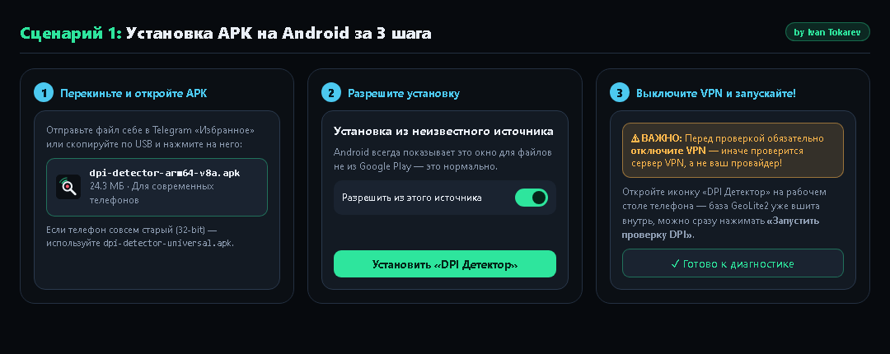
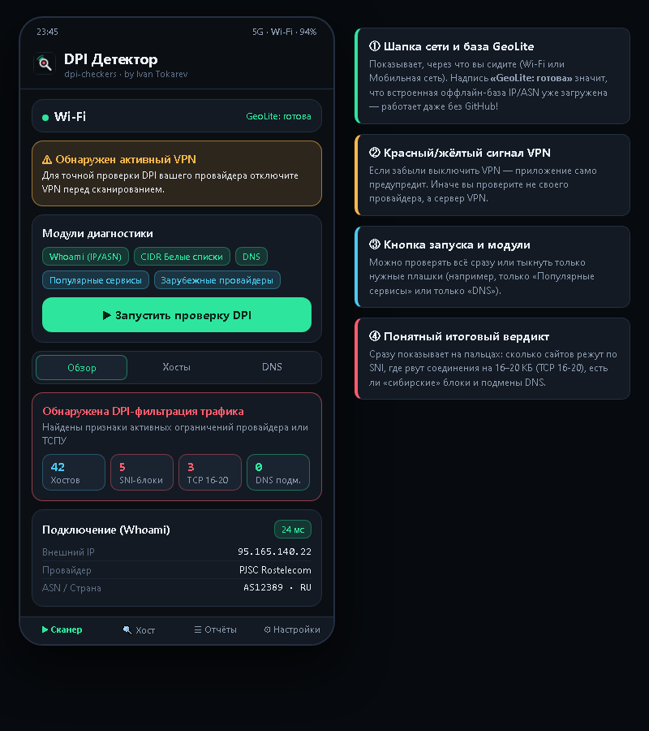
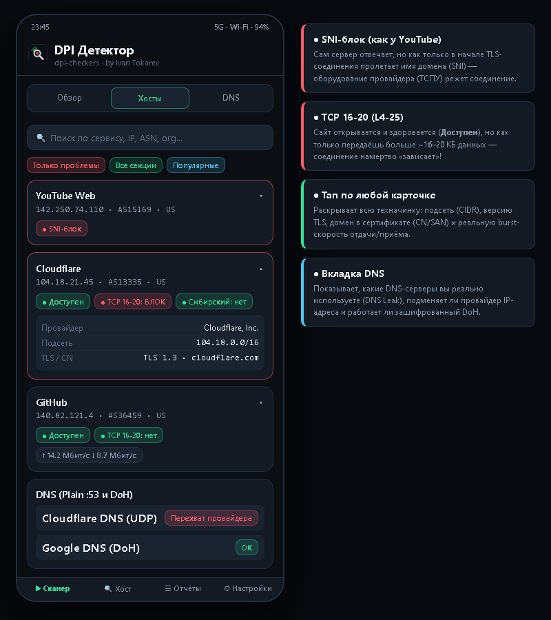
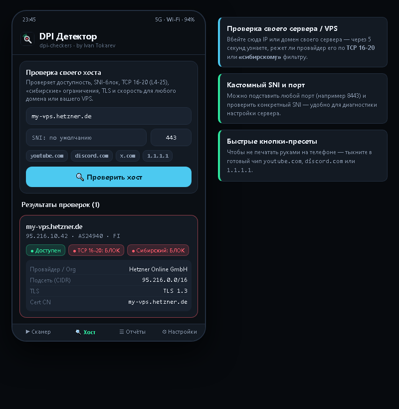
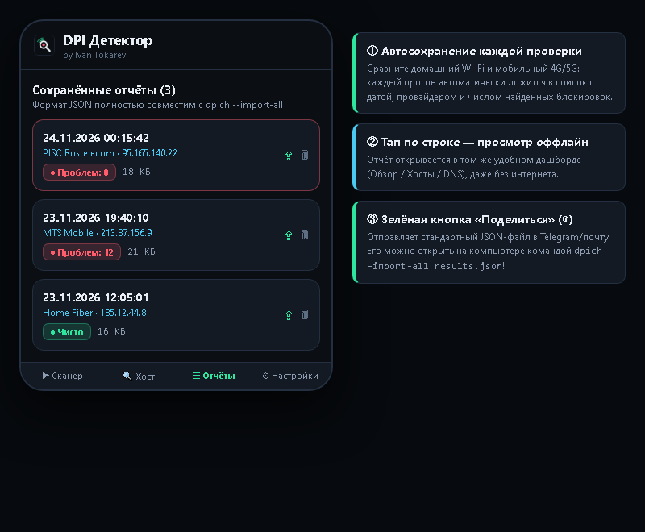
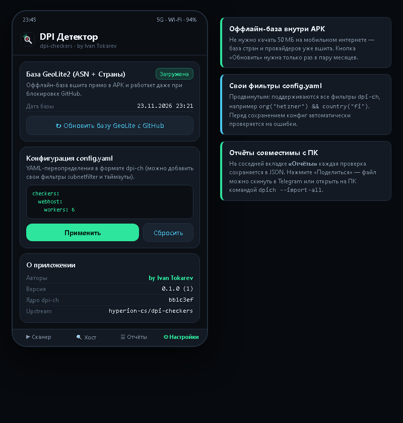
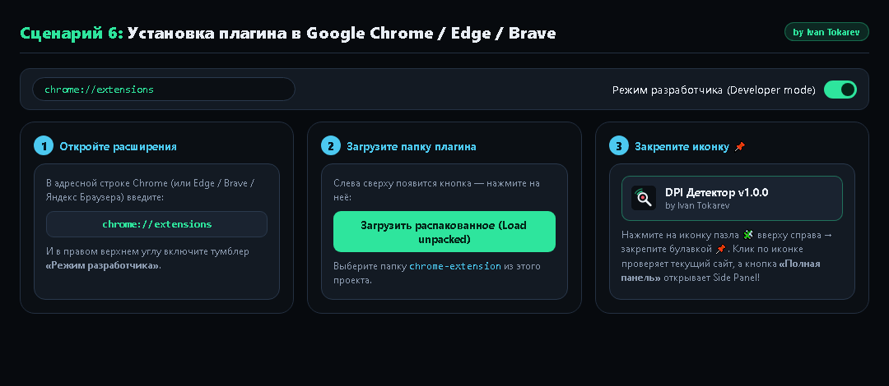
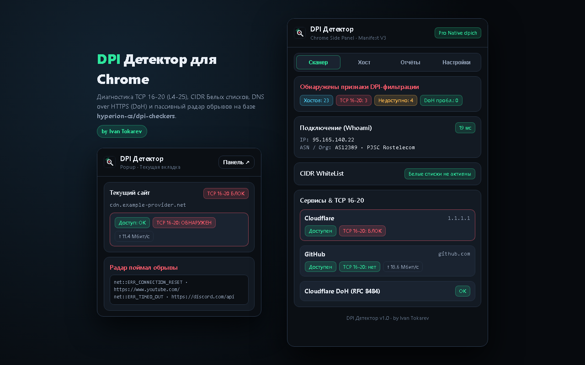

# DPI Детектор — простая инструкция «для деревенских» (все 7 сценариев со скриншотами)

**Авторы:** `by Ivan Tokarev`  
**На базе:** [hyperion-cs/dpi-checkers](https://github.com/hyperion-cs/dpi-checkers)

> Простыми словами: зачем это нужно?  
> Когда YouTube, Discord, Telegram или любимый сайт «крутит колёсико и не грузится» — непонятно, это сайт упал, роутер заглючил, или ваш провайдер (ТСПУ / DPI) специально режет трафик. **DPI Детектор** за минуту проверяет сеть и простыми словами говорит, **что именно** и **каким способом** режет провайдер.

> **Совет:** если открываете инструкцию локально на Windows и хотите смотреть её с картинками в браузере — просто кликните дважды по файлу **[GUIDE.html](GUIDE.html)**!

---

## Сценарий 1. Установка на телефон (Android)

1. Перекиньте на телефон файл **`dist/dpi-detector-arm64-v8a.apk`** (через Telegram «Избранное», кабель USB или облако). *(Для старых 32-битных телефонов возьмите `dpi-detector-universal.apk`.)*
2. Нажмите на файл → если Android покажет предупреждение «Неизвестный источник», включите тумблер → нажмите **«Установить»**.
3. **ВЫКЛЮЧИТЕ VPN перед проверкой!** Иначе вы проверите сервер VPN, а не своего провайдера.

---

## Сценарий 2. Главный экран «Сканер» — полная диагностика провайдера

1. Убедитесь, что сверху справа горит **`GeoLite: готова`** (оффлайн-база провайдеров и стран уже вшита в APK — работает даже при заблокированном GitHub!).
2. Если забыли выключить VPN — сверху появится жёлтое предупреждение.
3. Нажмите большую зелёную кнопку **«▶ Запустить проверку DPI»** и подождите 20–60 секунд.
4. Внизу сразу появится **вердикт** (зелёный / красный), счётчики блокировок и карточка **Whoami** (ваш IP, провайдер, ASN, задержка).

---

## Сценарий 3. Разбор заблокированных сайтов («Хосты») и DNS

- Переключитесь на **«Хосты»** и нажмите **«Только проблемы»** — останутся только те сайты, которые режет провайдер.
- Нажмите на любую карточку (например, `Cloudflare`) — она раскроется и покажет подсеть, TLS-версию, сертификат и скорость.
- Переключитесь на **«DNS»** — увидите утечки (DNS Leak), подмену/перехват обычного UDP DNS и работу зашифрованного DoH.

---

## Сценарий 4. Проверка одного конкретного сайта или своего VPS («Хост»)

1. Перейдите внизу на вкладку **«🔍 Хост»**.
2. Впишите любой домен или IPv4 (например `youtube.com`, `discord.com` или IP вашего VPS), при желании укажите свой SNI и порт (по умолчанию `443`), либо нажмите на готовую кнопку-пресет.
3. Нажмите **«Проверить хост»** — через 5 секунд будет полный разбор (SNI, TCP 16-20, «сибирский» фильтр, TLS, скорость).

---

## Сценарий 5. Сохранение, сравнение и отправка отчётов («Отчёты»)

- Каждая полная проверка сохраняется автоматически — удобно сравнить домашний Wi-Fi и мобильный 4G/5G.
- Нажмите на любую строку — отчёт откроется оффлайн в полном дашборде.
- Нажмите зелёную кнопку **«Поделиться»** — JSON-файл можно отправить в Telegram или открыть на ПК командой `dpich --import-all results.json`.

---

## Сценарий 6. Настройки, база GeoLite2 и свой `config.yaml`

- **База GeoLite2** уже вшита в приложение; кнопка **«Обновить базу GeoLite с GitHub»** нужна лишь раз в пару месяцев.
- В поле **`config.yaml`** продвинутые пользователи могут прописать свои фильтры `subnetfilter` (например, `org("hetzner") && country("fi")`), таймауты и количество потоков — перед сохранением конфиг проверяется автоматически.

---

## Сценарий 7. Установка и работа плагина в Google Chrome / Edge / Brave

### Шаг А. Установка за 30 секунд

1. Откройте в Chrome / Edge / Brave / Яндекс Браузере: `chrome://extensions`
2. В правом верхнем углу включите **«Режим разработчика» (Developer mode)**.
3. Нажмите **«Загрузить распакованное» (Load unpacked)** и выберите папку **`chrome-extension`**.
4. Закрепите иконку «DPI Детектор» булавкой 📌 на панели браузера.

### Шаг Б. Проверка сайтов прямо в браузере (Popup + Side Panel)

- **Клик по иконке (Popup):** проверяет текущий открытый сайт на TCP 16-20 (L4-25) в 1 клик и показывает обрывы, пойманные пассивным радаром (`ERR_CONNECTION_RESET`, `ERR_TIMED_OUT`).
- **Кнопка «Полная панель ↗» (Side Panel):** открывает сбоку полноценный 4-вкладочный дашборд с Whoami, CIDR WhiteList, проверкой сервисов, DoH и экспортом JSON.
- **Pro-режим:** скрипт `chrome-extension/install-native-host.ps1 -ExtensionId <ID>` подключает локальное Go-ядро `dist/dpich-native-host.exe` и добавляет SNI-пробы, «сибирские» ограничения и Plain UDP DNS прямо в Chrome.

---

## Словарь «на пальцах» — что означают красные статусы

| Надпись | Что происходит на самом деле |
|---|---|
| **SNI-блок** | Провайдер видит имя домена в самом начале HTTPS-соединения и тут же рвёт связь. Сам сервер при этом работает. |
| **TCP 16-20 (L4-25)** | Сайт «здоровается» (первые ~16–20 КБ проходят), но затем соединение намертво **зависает** после ~25-го пакета. |
| **Сибирский: БЛОК** | Региональный фильтр: одиночный запрос проходит, но серия параллельных соединений браузера Chrome тут же режется. |
| **Активен CIDR WhiteList** | Жёсткий режим «белых списков»: работают только разрешённые сайты (`ya.ru`, `vk.ru`, `max.ru`), остальной интернет отрезан по IP-подсетям. |
| **DNS Подмена / Перехват** | Провайдер перехватывает DNS-запрос и подсовывает фальшивый IP или ложный ответ «сайт не найден» (NXDOMAIN). |

---

*Авторы: **by Ivan Tokarev** · На базе `hyperion-cs/dpi-checkers` (Apache-2.0).*
